### yoons0717
FrontEnd Developer · South Korea

 
 

   &nbsp;<b>Stack</b> — TypeScript · Next.js · React · Zustand · Tailwind · Jest 
   &nbsp;<b>Interests</b> — Developer productivity tools, working alongside AI 
   &nbsp;<b>Notes</b> — What I learn, written down on my <a href="https://yoons0717.github.io">blog</a>

